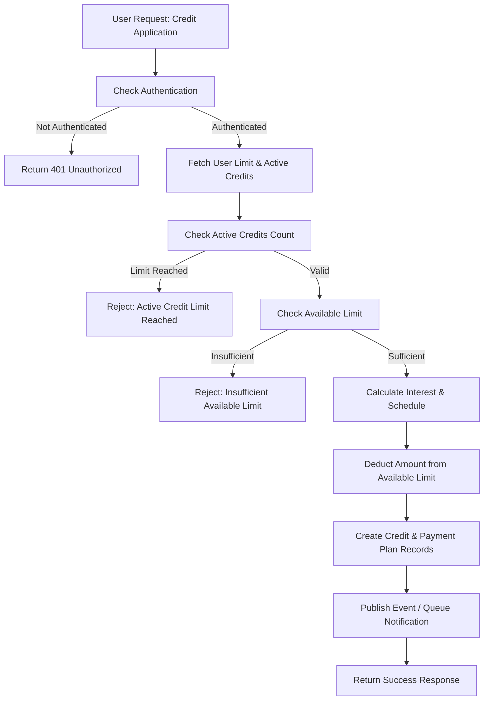

# 💳 Credit Management API

An enterprise-grade Backend API built with **NestJS**, **TypeScript**, **PostgreSQL**, and **Redis** for credit limit management, credit applications, automated installment planning, payment processing, and autonomous background cron jobs[cite: 1].

---

## 📐 System Architecture & Flowchart

Below is the core business logic flow for Credit Application & Score-based Evaluation[cite: 1]:



---

## 🚀 Core Features

* **Score-Group Limits & Interest Rates:** Dynamic score group assignment (A-D) on registration with configurable credit ceilings and interest rates[cite: 1].
* **Credit Calculator & Caching:** Repayment schedule and 7/30-day late fee simulation cached via Redis[cite: 1].
* **Idempotent Repayment:** Double-payment prevention using Redis Distributed Lock[cite: 1].
* **Autonomous Background Jobs:** Daily cron tasks running at `00:01` (Late-Check) and `09:00` (Reminders)[cite: 1].
* **Audit & Event Log:** Append-only notification history[cite: 1].

---

## 🛠️ Quick Start Guide

### 1. Prerequisites
* Node.js (v18+)
* Docker & Docker Compose

### 2. Infrastructure Setup
Run PostgreSQL and Redis via Docker Compose[cite: 1]:
```bash
docker compose up -d
```

### 3. Environment Variables (`.env`)
Create a `.env` file in the root directory based on `.env.example`[cite: 1]:
```env
NODE_ENV=development
PORT=3000

DB_HOST=localhost
DB_PORT=5432
DB_USERNAME=postgres
DB_PASSWORD=postgres
DB_DATABASE=credit_db

REDIS_HOST=localhost
REDIS_PORT=6379

JWT_SECRET=your_super_secret_jwt_key_here
JWT_EXPIRES_IN=1d

CREDIT_LIMIT_EXPIRY_MONTHS=6
SCORE_GROUP_LIMIT_A=50000
SCORE_GROUP_LIMIT_B=30000
SCORE_GROUP_LIMIT_C=15000
SCORE_GROUP_LIMIT_D=5000

MAX_ACTIVE_CREDITS=3
MIN_CREDIT_AMOUNT=100
MAX_TERM_COUNT=12
INSTALLMENT_INTERVAL_DAYS=30
REMINDER_DAYS_BEFORE_DUE=3

SNOOZE_FEE_RATE=0.05
MAX_SNOOZE_COUNT=2
SNOOZE_EXTENSION_DAYS=30
```

### 4. Application Setup & Migration
Install dependencies, run database migrations, and start the development server[cite: 1]:
```bash
npm install
npm run typeorm migration:run
npm run start:dev
```

* **API Server:** `http://localhost:3000`
* **Swagger UI Documentation:** `http://localhost:3000/api/docs`[cite: 1]

---

## 🔐 Endpoints Reference

| Method | Endpoint | Description |
| :--- | :--- | :--- |
| `POST` | `/auth/register` | Registers a new user & assigns a random score group (A-D) with base limit[cite: 1]. |
| `POST` | `/auth/login` | Authenticates user & returns JWT Access Token[cite: 1]. |
| `POST` | `/auth/refresh` | Refreshes existing JWT Access Token[cite: 1]. |
| `GET` | `/users/me` | Returns current user profile & credit limit summary[cite: 1]. |
| `GET` | `/users/me/limit` | Returns current user credit limit details[cite: 1]. |
| `GET` | `/credits/calculator` | Public repayment & 7/30-day late fee calculator (Redis Cached)[cite: 1]. |
| `POST` | `/credits` | Applies for a credit, generates payment schedule[cite: 1]. |
| `GET` | `/credits` | Lists all active & historical credits for the user[cite: 1]. |
| `GET` | `/credits/:id` | Returns detailed credit information[cite: 1]. |
| `GET` | `/credits/:id/payment-plans` | Lists installments with live computed `currentLate` fees[cite: 1]. |
| `POST` | `/credits/payment-plans/:id/pay` | Repays an installment with Idempotency Lock[cite: 1]. |
| `GET` | `/notifications` | Returns append-only notification log[cite: 1]. |

---

## 🧪 Manual Cron Job Testing Guide

To manually trigger autonomous background jobs in testing environments without waiting for scheduled times[cite: 1]:

1. Ensure the development server is running (`npm run start:dev`).
2. **Trigger Late-Check Job (00:01):** Send `POST http://localhost:3000/tasks-test/trigger-late-check`[cite: 1]
3. **Trigger Reminder Job (09:00):** Send `POST http://localhost:3000/tasks-test/trigger-reminders`[cite: 1]

---

## 📁 Technical Documentation & Diagrams

All system architecture specs and Mermaid diagrams are committed in the `/docs` directory[cite: 1]:

* 📐 **[Entity Relationship Diagram (ERD)](docs/erd.md)**[cite: 1]
* 🔄 **Sequence Diagrams:** `docs/sequence-*.md` (Registration, Credit Application, Calculator, Repayment, Crons)[cite: 1]
* 🏗️ **[System Architecture Diagram](docs/system-architecture.md)**[cite: 1]
* 📖 **[API Documentation & Error Codes](docs/api-documentation.md)**[cite: 1]