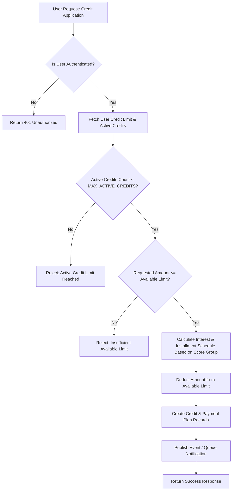

# 💳 Credit Management API

A enterprise-grade Backend API built with **NestJS**, **TypeScript**, **PostgreSQL**, and **Redis** for credit limit management, credit applications, automated installment planning, and payment processing.

---

## 📐 System Architecture & Flowchart

Below is the core business logic flow for Credit Application & Score-based Evaluation:



---

## 🛠️ Tech Stack & Features

* **Framework:** NestJS (Node.js / TypeScript)
* **Database:** PostgreSQL (via TypeORM)
* **Caching & Queue:** Redis
* **Containerization:** Docker & Docker Compose
* **Security:** JWT Authentication & Bcrypt Password Hashing

---

## 🚀 Quick Start Guide

### 1. Prerequisites
Make sure you have **Docker Desktop** and **Node.js (v18+)** installed.

### 2. Environment Setup
Clone the repository and ensure your `.env` file is present in the root directory.

### 3. Run Infrastructure (PostgreSQL & Redis)
```bash
docker compose up -d
```

### 4. Install Dependencies & Start Application
```bash
npm install
npm run start:dev
```

The API will be available at: `http://localhost:3000`

---

## 🔐 Auth Endpoints

| Method | Endpoint | Description |
| :--- | :--- | :--- |
| `POST` | `/auth/register` | Registers a new user & assigns a random score group (A-D) with base limit. |
| `POST` | `/auth/login` | Authenticates user & returns JWT Access Token. |